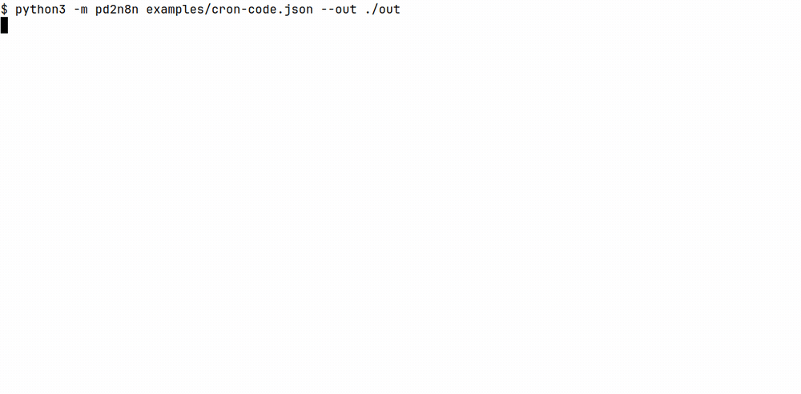

# pd2n8n

pd2n8n turns a Pipedream Workflows export into n8n workflow JSON. You import that file in n8n with Import from File.

Pipedream Workflows shuts down on 31 March 2027. Pipedream deletes workflow data, including credentials, by 30 April 2027. The export describes triggers, steps, and code. It does not include secrets. See [Workflows and String are shutting down](https://pipedream.com/docs/workflows) and [Export workflows](https://pipedream.com/docs/workflows/export-workflows).

## Install

You need Python 3.11 or newer. The converter has no runtime dependencies.

```bash
git clone https://github.com/kamilkaczmareksolutions/pipedream-to-n8n.git
cd pipedream-to-n8n
```

To run the tests, install pytest.

```bash
python3 -m pip install -e ".[dev]"
```

## Convert a workflow

Pass one workflow `.json` file or one project `.zip` from Pipedream. The `--out` directory receives one n8n JSON file per exported workflow. The command prints a report.

```bash
python3 -m pd2n8n examples/cron-code.json --out ./out
python3 -m pd2n8n examples/project-export.zip --out ./out
```

Exit code 0 means the files were written. A report that lists manual reconnects is still exit code 0. Exit code 1 means the path is missing, the JSON is not a workflow, or the zip has no exported workflow. On exit code 1 the command writes nothing.



## Limits

Credentials are never in the export. Reconnect each account in n8n after import.

The converter maps a schedule trigger to Schedule Trigger, an HTTP trigger to Webhook, and a JavaScript code step to a Code node. In that Code node, `steps.trigger.event` becomes `$('trigger').item.json`, and `steps.<name>.$return_value` becomes `$('<name>').item.json`. The Pipedream SDK is not available there. A `defineComponent` wrapper stays in the source so you can see the original step. Remove that wrapper before you run the node.

Python steps are copied into the Code node as comments. App actions, email triggers, form triggers, and source triggers become a NoOp node plus a sticky note that starts with "Reconnect manually". Conditional branches are named on a sticky note and are not rebuilt. Data stores, File Store files, environment variables, and private component source are not in the export.

## Examples

These files are fictional. They contain no real credentials.

- `examples/cron-code.json` is a Monday 09:00 schedule plus two JavaScript steps.
- `examples/http-code.json` is a POST webhook plus a Python step.
- `examples/mixed.json` is a webhook with a redacted prop, a Slack action, a disabled step, and an unconverted branch.
- `examples/project-export.zip` is a project export with two workflows and one skipped draft.

## Run the tests

```bash
python3 -m pytest -q
```

## License

MIT. See [LICENSE](LICENSE).
